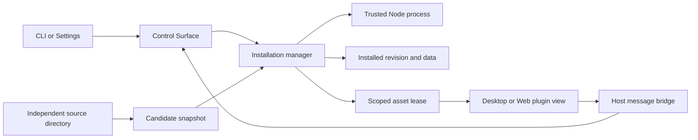

# Independent plugin runtime

The local-directory runtime extends the existing bundled registry. It does not
require an author to edit OpenCove, register a React component in the host, or run
a separate development web server. The package and browser API are in [API.md](API.md).

## Owners and boundaries

| State | Owner | Durable source |
| --- | --- | --- |
| Installation, source directory, active revision, enabled intent | `PluginInstallationManager`, one per Worker runtime | `plugins/installed.json` |
| Published package files | `LocalPluginFiles` | Immutable artifact directory |
| Backend execution, pending calls, logs | Child backend port and manager | Runtime only; restored from installed revision |
| Plugin SDK data | Manager with serialized filesystem writes | Plugin-private storage files |
| Preview data/backend | One view lease | Temporary memory/data directory; removed on close |
| Window geometry, pinned title and node identity | Existing workspace owners | Existing workspace persistence |
| Current content title, iframe, media object | Client presentation/view | Runtime only; authored plugin restores its own saved data |
| Entry visibility | Existing application settings owner | Existing contribution preferences |

Local plugins' enabled state belongs to the installation owner. The old
`disabledPluginIds` setting continues to govern bundled plugins, but cannot
override an independently installed plugin's enabled intent.

Desktop IPC and Web invoke use fixed validated `plugin.*` operations. The
Control Surface is a facade, not a second installation owner. A listener can stop
without disposing the Worker plugin manager. Plugin activation must not block
core Worker/PTY readiness.

Each plugin backend has full Node permissions on the runtime machine. A separate
process contains crashes and permits lifecycle management; it is not a security
sandbox. App renderers retain context isolation and no Node integration. UI
resources use their own response CSP; the application's CSP is not weakened.

## Invariants

1. Installation mutations have one serialized owner. Child health and renderer
   polling cannot rewrite installed intent. A missing/corrupt installation is
   visible as an error; it cannot silently erase nodes or user data.
2. A candidate is validated, copied and activated before the durable active
   record changes. Failed validation, activation or registry persistence keeps
   the previous process and files. Source edits alone never mutate active assets.
3. A view lease belongs to one plugin generation. Its asset URL exposes no Worker
   bearer token; the host binds every frame request to that view and checks its
   source/origin. Closing, disabling or replacing a generation revokes leases.
   Late replies cannot update a replacement view.

The iframe stays mounted at its expanded geometry during collapse. The browser
owns audio on the viewing device. Closing destroys the view; a shared backend can
remain alive until disable/reload/uninstall/shutdown. Do not infer continued audio
from a successful backend request: exercise the actual browser media element.

The injected SDK maintains a capability-scoped WebSocket on the asset listener.
It carries only view presence, with native ping/pong, and consumes no long-lived
HTTP request slots. Collapsed, idle and background views remain alive without
JavaScript heartbeats. Page departure explicitly releases the lease; an unopened
or disconnected view has a three-minute reconnection grace before its resources
and preview process are reclaimed. Closing or retiring a generation revokes the
connection immediately. Authors do not implement this lifecycle themselves.

## Initial scope and routing

Install and reload read a source directory on the connected runtime machine;
they do not upload a client directory to another Worker. Git source repositories
remain user-owned. The runtime neither resets nor modifies those repositories.

This iteration uses the same connected Home Worker for the Desktop plugin catalog,
RPC and resource URL resolver; Web uses its connected Worker. It does not yet
relocate an independent plugin backend according to a Space's remote mount.
For a mount-bound node, the view therefore receives no presumed local project
directory. `workspaceId` is context, not authority to access remote files.
Automatic mount routing, GitHub discovery/update and plugin CLI/skill contributions
remain later capabilities.

## Verification

Keep regressions at three levels: manager/child tests for atomic activation,
restore and cleanup; HTTP contracts for auth, lease revocation and resource paths;
real Desktop/Web tests installing the published example from an independent
directory. The authoring acceptance test is a fresh Agent that receives product
requirements and `opencove plugin guide`, without host-source instructions.

The design applies the process and message-boundary principles documented in
[VS Code's extension host](https://code.visualstudio.com/api/advanced-topics/extension-host)
and [webview API](https://code.visualstudio.com/api/extension-guides/webview), while
keeping OpenCove's Worker ownership and persistent canvas windows.
