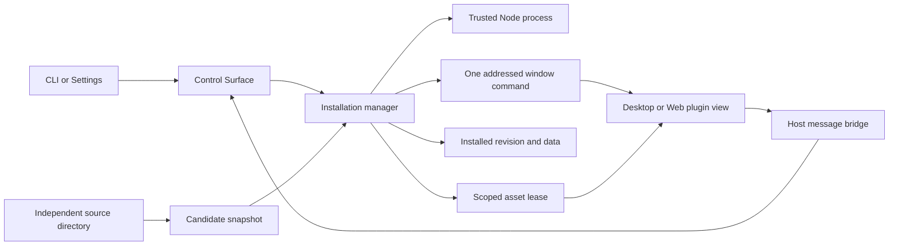

# Independent plugin runtime

The installation registry is the sole source of available plugins. A fresh
installation has no bundled validation plugins. Authors do not edit OpenCove,
register a React component in the host, or run
a separate development web server. The package and browser API are in [API.md](API.md).

## Owners and boundaries

| State | Owner | Durable source |
| --- | --- | --- |
| Installation, source directory, active revision, enabled intent | `PluginInstallationManager`, one per Worker runtime | `plugins/installed.json` |
| Published package files | `LocalPluginFiles` | Immutable artifact directory |
| Backend execution, pending calls, logs | Child backend port and manager | Runtime only; restored from installed revision |
| Command and skill declarations | Installed package, projected by the manager | Immutable manifest for the installed revision |
| Window-command readiness and pending replies | `PluginWindowCommands`, bound to one view connection | Runtime only; never persisted or retried |
| Plugin SDK data | Manager with serialized filesystem writes | Plugin-private storage files |
| Preview data/backend | One view lease | Temporary memory/data directory; removed on close |
| Window geometry, pinned title and node identity | Existing workspace owners | Existing workspace persistence |
| Singleton window identity | Workspace plugin-window policy on the connected Worker | Existing plugin nodes across all projects; no second singleton registry |
| Reported content title | Client view; manager records one observation per real view lease | Runtime only; expires with the lease, never rewrites saved/user-pinned names |
| Iframe, media object | Client presentation/view | Runtime only; authored plugin restores its own saved data |
| Entry visibility | Existing application settings owner | Existing contribution preferences |

Plugin enabled state belongs to the installation owner. Legacy
`disabledPluginIds` settings cannot override installed enablement. Removing a
plugin implementation leaves its existing canvas nodes intact as unavailable
windows; installing a matching compatible package can make them usable again.

Desktop IPC and Web invoke use fixed validated `plugin.*` operations. The
Control Surface is a facade, not a second installation owner. A listener can stop
without disposing the Worker plugin manager. Plugin activation must not block
core Worker/PTY readiness.
Command names remain data inside the plugin owner. The fixed command facade does
not hot-register new top-level Control Surface handlers after installation.

Each plugin backend has full Node permissions on the runtime machine. A separate
process contains crashes and permits lifecycle management; it is not a security
sandbox. App renderers retain context isolation and no Node integration. UI
resources use their own response CSP; the application's CSP is not weakened.

## Invariants

1. Installation mutations have one serialized owner. Child health and renderer
   polling cannot rewrite installed intent. A missing/corrupt installation is
   visible as an error; it cannot silently erase nodes or user data.
2. A candidate is validated, copied and activated before the durable active
   record changes. Failed validation, activation or registry persistence keeps
   the previous process and files. Source edits alone never mutate active assets.
3. A view lease belongs to one plugin generation. Its asset URL exposes no Worker
   bearer token; the host binds every frame request to that view and checks its
   source/origin. Closing, disabling or replacing a generation revokes leases.
   Late replies cannot update a replacement view.
4. A window command names a durable node and reaches exactly one ready document.
   Previews are excluded. Multiple ready clients require an explicit view ID;
   neither focus nor a singleton node implies a unique physical browser. Missing
   acknowledgments never trigger command replay.

Atomic publication protects the installed record and active code generation.
Candidate activation may overlap the previous backend and receives the same
private data directory. Failed activation or publication cannot undo data writes,
schema migrations, network requests or other side effects already performed by
that candidate. Authors must make activation safe to overlap and keep data
compatible with the still-active version. Disposal owns only resources created
by that instance; it must not erase shared data used by its replacement.

The iframe stays mounted at its expanded geometry during collapse. The browser
owns audio on the viewing device. Closing destroys the view; a shared backend can
remain alive until disable/reload/uninstall/shutdown. Do not infer continued audio
from a successful backend request: exercise the actual browser media element.

The injected SDK maintains a capability-scoped WebSocket on the asset listener.
It carries native ping/pong presence plus the versioned window-command protocol,
and consumes no long-lived HTTP request slots. Collapsed, idle and background views remain alive without
JavaScript heartbeats. Page departure explicitly releases the lease; an unopened
or disconnected view has a three-minute reconnection grace before its resources
and preview process are reclaimed. Closing or retiring a generation revokes the
connection immediately. Authors do not implement this lifecycle themselves.

Protocol 2 advertises readiness only after parent initialization and registration
of `api.onCommand`. The Worker validates each reply on its originating connection;
request IDs cannot satisfy another view's pending call. Requests are bounded to
1 MiB and replies to 2 MiB; each connection has at most 128 pending calls, each
with a 30-second deadline. A connection loss rejects its pending commands while
the ordinary view lease may remain eligible for reconnection. Reconnection can
restore readiness but does not replay actions or accept old replies.

`target: "plugin"` calls the shared backend's `runCommand` with `pluginId`.
Declared host-menu invocations additionally carry validated selection context;
CLI calls do not infer that selection. `target: "window"` calls the selected iframe's handler, including for
packages without a backend. View-to-backend `invoke` keeps its original scoped
context and is a separate entry. A package without `view` can provide backend
commands, skills, preferences or themes but cannot open a canvas window or preview.

`view.instances: "single"` means one durable node across the connected Worker's
projects. Closing removes that node; reopening can create a fresh one while
private data remains. The default `multiple` preserves old manifest behavior and
requires explicit node selection for commands. Workspace persistence owns window
creation; the plugin manager neither fabricates nodes nor opens hidden leases to
execute commands. See [Commands and skills](./COMMANDS.md) for readiness, placement
and client-selection behavior.

## Initial scope and routing

Install and reload read a source directory on the connected runtime machine;
they do not upload a client directory to another Worker. Local-directory source repositories remain user-owned. Managed Git operations
prepare isolated source candidates and publish through the same installation
owner; see [distribution](./DISTRIBUTION.md). They do not reset or stash personal
changes in the previous editable checkout.

This iteration uses the same connected Home Worker for the Desktop plugin catalog,
RPC and resource URL resolver; Web uses its connected Worker. It does not yet
relocate an independent plugin backend according to a Space's remote mount.
For a mount-bound node, the view therefore receives no presumed local project
directory. `workspaceId` is context, not a local filesystem path. The
[host facade](./HOST_API.md) resolves explicit project/Space selections and routes
supported file reads and mutations, node and session controls, and bounded
process operations through their owners. File and process execution follows the
resolved mount; canvas node identity remains on the connected Worker.
Direct Node calls remain on the plugin backend's machine. Git source installation,
updates and repository discovery use the connected Worker; a discovered repository
is not an installed plugin.
Skill reads use the installed snapshot and return its Worker-local path, exact
text and an installation prompt. They do not execute skill instructions or write
to agent-owned directories. Disabled installations can still expose their skills.

Host operations are owned by an immutable backend generation or an exact real-view
lease. Preview and unpublished activation contexts cannot issue them. Retiring an
owner cancels its transient processes; delayed results cannot revive it or acquire
another owner's operation. The child-to-host RPC has bounded pending requests,
payload sizes and deadlines. A disconnected or hung backend control channel retires
that generation rather than silently retrying possibly executed actions. Operation
handles are not persisted or replayed after Worker restart.

## Verification

Keep regressions at three levels: manager/child tests for atomic publication,
restore, declaration validation, JSON bounds and cleanup; HTTP/WebSocket contracts
for auth, lease revocation, readiness, addressed replies and resource paths;
real Desktop/Web tests installing the published example from an independent
directory. The authoring acceptance test is a fresh Agent that receives product
requirements and `opencove plugin guide`, without host-source instructions.
Command acceptance must also exercise no-window backend execution, real browser
handlers, multi-client ambiguity, reload/disconnect fencing and lack of retries.
Singleton tests use durable nodes across projects and concurrent opens; a lease
count cannot prove singleton correctness.

The design applies the process and message-boundary principles documented in
[VS Code's extension host](https://code.visualstudio.com/api/advanced-topics/extension-host)
and [webview API](https://code.visualstudio.com/api/extension-guides/webview), while
keeping OpenCove's Worker ownership and persistent canvas windows.
Command metadata and execution remain separate as in
[VS Code commands](https://code.visualstudio.com/api/extension-guides/command);
packaged instructions follow the [Agent Skills format](https://agentskills.io/specification).
