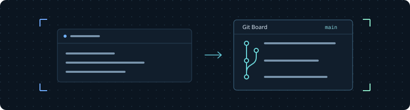

## 把仓库放在工作旁边

Git Board 将仓库状态与纵向提交历史放进画布窗口。在 Agent、终端或文件旁边打开它，随时查看当前进展。

### 打开一个 Git Board

1. 打开关联 Git 仓库的项目或 Space。
2. 在画布右键菜单或操作栏中选择 **Git Board**。
3. 修改代码后，点击 **刷新** 获取最新状态。

窗口读取目标 Space 对应的仓库，也支持已连接的远程位置。它和其他画布窗口一样，可以移动、缩放尺寸或收起。

### 一眼看到关键信息

| 窗口内容 | 说明 |
| --- | --- |
| 分支 | 仓库当前所在的分支 |
| 工作区状态 | 工作区是否干净，以及变更文件数量 |
| 领先 / 落后 | 相对于上游分支的提交数量 |
| 提交历史 | 最近的提交、哈希值与提交说明 |



当前 Git Board 用于查看仓库状态，不会执行提交、切换分支或修改文件。

### 按你的习惯摆放

拖动标题栏移动窗口，拖动边缘或四角调整大小。暂时不用时可以收起为画布图标，点击图标即可恢复。位置、尺寸与收起状态都会随工作区保存。

停用插件会保留已有窗口和配置。在 **设置 → 插件** 中重新启用即可恢复内容。内置插件随 OpenCove 一起更新。

### 从这个插件开始创造

让你的 Agent 执行：

```sh
opencove plugin guide
```

该指令返回插件文档的 README 与所在目录，说明现有扩展能力以及仍在开发的部分。

了解更多 [Git 提交历史](https://git-scm.com/docs/git-log)。
